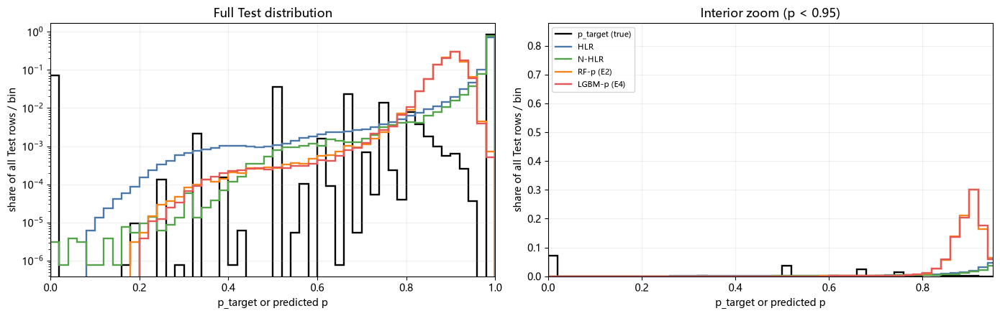
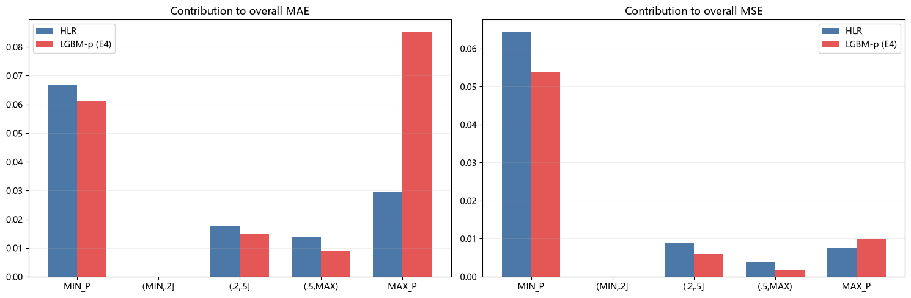

# 模型结构、预测目标与特征对间隔重复回忆率预测的影响

## 1. Introduction

间隔重复利用复习之间的时间间隔帮助学习者保持记忆。要描述词元随时间遗忘的过程，需要估计学习者再次遇到该词元时的回忆率。一个有意义的研究问题是：是否可以通过学习者过往的表现来预测下一次学习的表现？在本项目及相关工作中，预测值 `p_recall` 是一次学习或练习 session 中该词元被正确回忆的比例；它是记录级的观测值。

Half-Life Regression（HLR）先根据学习历史估计记忆半衰期，再结合距上次练习的时间计算回忆率。原研究在 Duolingo 约 1290 万条学习记录上评估了这一方法 (Settles & Meeder, 2016)。

Zaidi 等人在 HLR 基础上研究了语言学、心理学和用户特征，并尝试用神经网络表示遗忘曲线。他们从同一 Duolingo 数据中筛选英语学习者，使用约 428 万条记录 (Zaidi et al., 2020)。

受到上述两篇工作的启发，本项目想要研究的问题是：**不同的模型结构、预测目标和新增特征如何影响 `p_recall` 的预测表现？**我们使用清洗后的完整发布数据，统一比较 HLR、用户与语言特征扩展、神经半衰期模型、随机森林和 LightGBM。研究贡献是同一数据切分与测试口径下的实证比较，并分析不同评价指标和复习间隔下的结果。

## 2. Data and Preprocessing

### 2.1. Dataset

我们使用 Duolingo 发布的学习记录 (Settles & Meeder, 2016)，共 **12,854,226 行、12 列**。每行是一名学习者对一个词元的一次学习或练习 session。各字段含义如下：

| Variable | Description |
|:--|:--|
| `p_recall` | 本次正确回忆比例 |
| `timestamp` | 本次 session 的时间戳 |
| `delta` | 距上次练习的时间（秒） |
| `user_id` | 学习者标识 |
| `learning_language` | 学习语言 |
| `ui_language` | 界面语言 |
| `lexeme_id` | 词元标识 |
| `lexeme_string` | 词元文本标记 |
| `history_seen` | 此前练习次数 |
| `history_correct` | 此前正确次数 |
| `session_seen` | 本次练习次数 |
| `session_correct` | 本次正确次数 |

其中，`p_recall = session_correct / session_seen`，是 session 内的比例。

### 2.2. Data cleaning

我们先按全部 12 列检查完全重复的行，发现 **81** 条，保留首次出现的记录并删除其余重复行，得到 **12,854,145** 行。随后检查所有字段是否缺失，并检查数值字段的类型、有限值、取值范围及计数关系，包括 `p_recall` 是否与 `session_correct / session_seen` 一致。清洗后的数据中没有记录违反这些基础有效性规则。

我们还发现 **101,466 行**数据存在历史计数异常。例如，较晚记录的 `history_seen` 可能小于先前记录的 `history_seen + session_seen`。同一学习者和词元的记录在时间上相互关联，直接删除异常行可能使后续历史计数难以解释；原 HLR 工作未提供可直接采用的修复规则 (Settles & Meeder, 2016)。因此我们保留这些行，不改写计数。

### 2.3. Feature preparation

首先，将 `delta` 从秒换算为天，记为 `Δ = delta / 86400`。其次，将回忆率裁剪为 `p = clip(p_recall, 0.0001, 0.9999)`，作为共同的训练和评价标签。需要半衰期目标的模型再计算 `h = clip(−Δ / log₂(p), 15/1440, 274)` 天；`h` 由标签p_recall反推，并非独立观测值。

输入特征从此前历史表现构建。令 `c = history_correct`、`w = history_seen − history_correct`，基础向量为 `x_base = [√(1+c), √(1+w), 1]`。在此基础上，各模型使用以下输入：

| Input features | Models |
|:--|:--|
| `x_base` | HLR -lex、N-HLR -lex、RF -h、LGBM -h |
| `x_base` + 词元 one-hot | HLR、N-HLR |
| `x_base` + 词元 one-hot + 用户和/或语言 one-hot | HLR-User、HLR-Lang、HLR-User+Lang |
| `x_base` + `Δ` | RF-p、LGBM-p |
| 无输入特征 | Train mean |

词元类别由 `learning_language:lexeme_string` 构成；用户与语言分别由 `user_id`、`learning_language` 和 `ui_language` 编码。为防止标签泄露，本次 session 的 `session_seen` 和 `session_correct` 不作为输入。

### 2.4. Limitations and potential biases

保留历史计数异常行可能使部分历史特征带有噪声。如果异常集中于某些学习者、词元或语言，模型比较也可能受到偏倚。现有数据无法判断这种影响的方向或大小，因此结果应理解为基于保留这些记录的离线数据所得。

## 3. Methodology

### 3.1. Baselines

**Baseline 1 — HLR.** HLR 以记忆半衰期表示遗忘过程 (Settles & Meeder, 2016)。我们使用 `x_base` 加训练集词元 `learning_language:lexeme_string` 的 one-hot 特征作为输入 `x`，先估计半衰期，再由遗忘曲线预测回忆率：

$$
\hat h=\operatorname{clip}(2^{\theta^\top x},15/1440,274),
\qquad
\hat p=\operatorname{clip}(2^{-\Delta/\hat h},0.0001,0.9999).
$$

训练损失同时考虑回忆率、半衰期和参数正则化：

$$
L_{\mathrm{HLR}}=\sum_i\left[(p_i-\hat p_i)^2+0.01(h_i-\hat h_i)^2\right]+0.1\lVert\theta\rVert_2^2.
$$

HLR 用一轮逐样本更新训练，初始学习率为 `0.001`，并按特征出现次数衰减。

**Baseline 2 — HLR -lex.** 只去掉 HLR 的词元 one-hot，保留三个基础输入及相同的预测公式、损失和训练方法，以检查词元特征的作用。

**Baseline 3 — Train mean.** 对所有记录预测训练集 `p` 的均值，不使用输入特征，也不预测半衰期。

### 3.2. Additional features for HLR

以下模型都以完整 HLR 的输入 `x_HLR = [x_base, 词元 one-hot]` 为基础。加入的类别特征用于检验学习者和语言信息是否能解释仅靠练习历史与词元无法捕捉的差异。

**HLR-User.** 输入为 `[x_HLR, user_id one-hot]`。Train 中共有 **92,392** 名用户，因此新增 92,392 个特征，总输入维度为 **110,748**。我们加入用户标识，是为了让模型学习不同学习者的系统性回忆差异。

**HLR-Lang.** 输入为 `[x_HLR, learning_language one-hot, ui_language one-hot]`。两列语言分别增加 **6** 维和 **4** 维，总输入维度为 **18,366**。我们加入这两列，是为了检验学习语言和界面语言是否对应不同的回忆表现。

**HLR-User+Lang.** 输入同时包含 `x_HLR`、用户 one-hot 和两列语言 one-hot，总维度为 **110,758**。这一版本检验语言信息在已有用户特征的基础上是否还能提供帮助。

三个模型均使用第 3.1 节的遗忘曲线、损失函数和训练方法。

### 3.3. Neural half-life regression

参考神经半衰期模型 (Zaidi et al., 2020)，我们保留 HLR 的遗忘曲线，把线性的 `θᵀx` 换成含 **4 个 ReLU 隐藏单元**的网络，以检验非线性特征组合是否有帮助。网络输出为：

$$
\log_2\hat h=W_2^\top\operatorname{ReLU}(W_1^\top x)+b.
$$

再按第 3.1 节的公式计算 `ĥ` 和 `p̂`。

**N-HLR** 使用基础输入与词元特征，**N-HLR -lex** 仅使用基础输入。两者由对应的线性 HLR 权重初始化，使用损失 `MSE(p) + 0.0001 MSE(log₂ h) + 10⁻⁶ L2`。

| 模型 | 超参数 |
|:--|:--|
| N-HLR | 隐藏单元 4；Adam；学习率 0.0001；批量 8192；最多 5 轮；Validation 选定第 5 轮 |
| N-HLR -lex | 隐藏单元 4；Adam；学习率 0.0001；批量 8192；最多 5 轮；Validation 选定第 5 轮 |

### 3.4. Tree-based models

#### 3.4.1. 模型介绍

除了神经网络，我们还检验基于决策树的方法能否学习更复杂的非线性关系。我们采用 Breiman (2001) 提出的随机森林（RF）和 Ke et al. (2017) 提出的 LightGBM，并为每种算法设置两种训练目标：先预测半衰期、再代入遗忘曲线计算 `p̂`，或直接预测 `p`。组合后共有四个模型，均使用平方误差训练，不加入词元、用户或语言 one-hot：

- **RF -h：** RF 使用 `x_base` 预测 `log₂(h)`，转换为半衰期后按 HLR 曲线计算 `p̂`。
- **RF-p：** RF 使用 `[x_base, Δ]` 直接预测 `p`，再将预测值裁剪至 `[0.0001, 0.9999]`。
- **LGBM -h：** LightGBM 使用与 RF -h 相同的输入和目标，再按同一遗忘曲线计算 `p̂`。
- **LGBM-p：** LightGBM 使用与 RF-p 相同的输入和目标，直接得到裁剪后的 `p̂`。

Direct-p 模型不直接预测半衰期；从 `p̂` 反推的半衰期只用于诊断。由于 direct-p 版本还增加了 `Δ` 输入，它与半衰期版本的差异不能单独归因于预测目标。

| 模型 | 超参数 |
|:--|:--|
| RF -h | `n_estimators=100`, `max_depth=8`, `min_samples_leaf=50` |
| RF-p | `n_estimators=100`, `max_depth=12`, `min_samples_leaf=50` |
| LGBM -h | `learning_rate=0.05`, `num_leaves=15`, `min_child_samples=50`, 最佳轮次 271 |
| LGBM-p | `learning_rate=0.05`, `num_leaves=15`, `min_child_samples=200`, 最佳轮次 333 |

#### 3.4.2. 选参策略

RF 的六组候选为树深 `8/12/16` × 最小叶节点样本数 `50/100`，每组使用 **100** 棵树；LightGBM 的六组候选为叶子数 `15/31/63` × 最小叶节点样本数 `50/200`，学习率为 `0.05`。四个模型共用固定抽取的 **20 万条 Train** 进行候选拟合，分别按完整 Validation 的 `MAE(p)` 选配置，再用全部 Train 重新拟合。LightGBM 最多训练 **1000** 轮；候选及全量拟合都以 Validation 目标均方误差进行 **50** 轮提前停止。

## 4. Experiments

### 4.1. Data split and model selection

清洗后的 **12,854,145** 行按原文件顺序划分为 **Train 72%（9,254,984 行）**、**Validation 18%（2,313,746 行）**和 **Test 10%（1,285,415 行）**。Train 用于模型训练，Validation 用于选参和提前停止，Test 用于最终评估。

### 4.2. Experimental questions and evaluation metrics

实验围绕三个问题：

1. **新增特征是否改善 HLR？** 比较 HLR 与 HLR -lex，以及 HLR 与三个用户/语言特征扩展模型。
2. **非线性模型是否改善预测？** 将 N-HLR 与对应的 HLR 基线比较，并将树模型与 HLR、Train mean 比较。
3. **树模型的预测方式有何影响？** 分别比较 RF -h 与 RF-p、LGBM -h 与 LGBM-p。

十二个模型在同一批 Test 记录上评价。主指标为平均绝对误差（MAE）、均方根误差（RMSE）和 AUC。设 `p_i` 为第 `i` 条记录裁剪后的真实回忆率，`p̂_i` 为预测值，Test 样本数为 `N`，则

$$
\operatorname{MAE}(p)=\frac{1}{N}\sum_{i=1}^{N}|p_i-\hat p_i|,
\qquad
\operatorname{RMSE}(p)=\sqrt{\frac{1}{N}\sum_{i=1}^{N}(p_i-\hat p_i)^2}.
$$

MAE 描述平均误差，RMSE 对大误差更敏感。计算 AUC 时，将 `y_i = np.rint(p_i)` 作为记录级二值标签。设正、负标签的记录数分别为 `N₊`、`N₋`，则

$$
\operatorname{AUC}=\frac{1}{N_+N_-}\sum_{i:y_i=1}\sum_{j:y_j=0}
\left(\mathbf{1}[\hat p_i>\hat p_j]+\tfrac12\mathbf{1}[\hat p_i=\hat p_j]\right).
$$

AUC 衡量正标签记录排在负标签记录前面的能力，并列预测计半分。MAE、RMSE 越低越好，AUC 越高越好。
### 4.3. leakage controls

为避免标签泄漏，本次 session 的 `session_seen/session_correct`、`p` 和由它反推的 `h` 都不作为输入；词元、用户和语言词表也不从 Validation/Test 学习。Test 标签没有用于拟合、提前停止或超参数选择。不过，部分基线的 Test 指标在统一汇总前已被查看，因此不能将后续 Test 分组和误差分析视为独立的验证。按行切分也未隔离学习者，同一用户可能出现在不同集合，结果不能直接推广为对全新用户的表现。

### 4.4. Computing Environment and Reproducibility

| Item | Setting |
|:--|:--|
| OS | Windows 10 Home，64 位 |
| CPU | Intel Core i5-1135G7，4 核 / 8 线程 |
| Memory | 约 8 GB |
| Compute | CPU；训练未使用 GPU |
| Python environment |Python 3.11.17 |
| Main packages | NumPy 2.4.6；pandas 3.1.1；scikit-learn 1.9.1；LightGBM 4.7.0 |

RF 使用 scikit-learn 实现 (Pedregosa et al., 2011)。实验以随机种子 **42** 为基础；树模型候选抽样使用 42/43，神经网络的训练顺序使用 52。没有使用外部预训练检查点；N-HLR 由本实验的 HLR 权重初始化。每个配置只运行一次，没有跨随机种子的重复实验。

源代码可在 `<this github repo>` 找到。
## 5. Results and Discussion

### 5.1. Overall results

表 1–4 比较清洗后同一批 **1,285,415 条 Test 记录**上的十二个模型。MAE 和 RMSE 是回忆率的绝对误差与均方根误差，单位均为回忆率比例（无量纲），越低越好；AUC 衡量模型区分二值回忆结果的排序能力，也无量纲，越高越好。二值标签由 `np.rint(p_target)` 得到，指标定义见 4.2。所有模型使用相同的数据切分和 Test 评估口径。加粗仅标出十二个模型中各列的最佳数值，不表示统计显著性。

**表 1. Baseline 的 Test 结果。**

| 模型 | MAE ↓ | RMSE ↓ | AUC ↑ |
|:--|--:|--:|--:|
| HLR | 0.128033 | 0.290877 | 0.537856 |
| HLR -lex | 0.128283 | 0.290873 | 0.537459 |
| Train mean | 0.174210 | 0.271138 | 0.500000 |

**表 2. Adding features to HLR 的 Test 结果。**

| 模型 | MAE ↓ | RMSE ↓ | AUC ↑ |
|:--|--:|--:|--:|
| HLR-User | 0.127069 | 0.290409 | 0.540654 |
| HLR-Lang | 0.127938 | 0.290823 | 0.537993 |
| HLR-User+Lang | 0.126819 | 0.290242 | 0.540222 |

**表 3. NN 的 Test 结果。**

| 模型 | MAE ↓ | RMSE ↓ | AUC ↑ |
|:--|--:|--:|--:|
| N-HLR | **0.118898** | 0.287320 | 0.539874 |
| N-HLR -lex | 0.118909 | 0.287335 | 0.540314 |

**表 4. Tree-based models 的 Test 结果。**

| 模型 | MAE ↓ | RMSE ↓ | AUC ↑ |
|:--|--:|--:|--:|
| RF -h | 0.164276 | 0.317893 | 0.549080 |
| RF-p | 0.170206 | **0.267520** | 0.604966 |
| LGBM -h | 0.164277 | 0.317891 | 0.549281 |
| LGBM-p | 0.170254 | 0.267539 | **0.605412** |

通过上表的结果，我们有以下发现：

1. 基于神经网络的N-HLR 和 N-HLR -lex在预测误差MAE上表现最好。与 HLR 相比，**N-HLR 的 MAE 从 0.128033 降至 0.118898**，是全部模型中最低的；加入词元后，N-HLR 的 MAE 几乎不变。

2. 在原始的HLR上新增user_id和学习语言作为额外特征并没有带来太大的提升。HLR-User+Lang 将 MAE 降至 0.126819，比原始HLR有略微提升；单独加入用户特征或单独加入语言特征并没有给结果带来太大的变化。

3. 同一预测方式下，RF 与 LGBM 的结果几乎一致：RF -h 与 LGBM -h 的 MAE 分别为 **0.164276** 和 **0.164277**；RF-p 与 LGBM-p 的 AUC 分别为 **0.604966** 和 **0.605412**。相比之下，RF 从 `-h` 改为 `-p` 时，RMSE 从 **0.317893** 降至 **0.267520**，AUC 从 **0.549080** 升至 **0.604966**，但 MAE 从 **0.164276** 升至 **0.170206**；LGBM 也呈现同样趋势。由于 `-p` 版本同时改变了预测目标和输入特征，这些差异不能只归因于预测目标。

4. 不同模型在不同指标上的表现不一。与 HLR 的 **MAE 0.128033、RMSE 0.290877、AUC 0.537856** 相比，RF-p 和 LGBM-p 的 MAE 更高（分别为 **0.170206** 和 **0.170254**），RMSE 更低（**0.267520** 和 **0.267539**），AUC 更高（**0.604966** 和 **0.605412**）。若重视平均绝对误差，N-HLR 更合适；若重视较大误差或已发生记录的二值排序，直接预测回忆率的树模型更有优势。

另外，HLR 的 MAE 低于 LGBM-p（**0.128033 对 0.170254**），RMSE 却更高（**0.290877 对 0.267539**）。第 7 节的误差分解表明，Test 标签有 **83.60%** 位于回忆率上界，HLR 对这批记录的预测误差较小，因此整体 MAE 较低；但它对低回忆率记录的高估更严重，大误差的平方使其 RMSE 较高。这解释了两个指标为何给出不同的模型排序。

## 6. Conclusion

在相同的清洗数据和 Test 记录上，**N-HLR 的 MAE 最低（0.118898）**，低于 HLR 的 0.128033；加入用户及语言特征使 HLR 的 MAE 小幅降至 0.126819，单独加入语言或词元特征没有显示明显收益。直接预测回忆率的 RF-p 的 RMSE 最低（0.267520），LGBM-p 的 AUC 最高（0.605412），但两者的 MAE 均高于 HLR；预测半衰期的树模型没有改善 HLR 的 MAE 或 RMSE。标签大量集中在高回忆率端，解释了不同模型在 MAE 与 RMSE 上的相反排序。这些结果支持按评价目标区分模型表现，但没有一个模型在全部指标上最优。

这些结论仅适用于当前按记录切分的离线测试。部分历史计数异常被保留，同一学习者也可能同时出现在训练和测试中；因此微小的指标差异和对全新学习者的效果仍不确定。神经模型同时改变了损失与优化方式，direct-p 树模型同时改变了预测目标和输入，现有比较不能把收益单独归因于模型结构或目标。对于未来的工作，可以在相同输入下单独比较预测目标，进行多随机种子和按学习者隔离的评估，并检查历史计数异常对结果的影响。

## References

Breiman, L. (2001). Random forests. *Machine Learning, 45*(1), 5–32.

Ke, G., Meng, Q., Finley, T., Wang, T., Chen, W., Ma, W., Ye, Q., & Liu, T.-Y. (2017). LightGBM: A highly efficient gradient boosting decision tree. In *Advances in Neural Information Processing Systems* (Vol. 30).

Pedregosa, F., Varoquaux, G., Gramfort, A., Michel, V., Thirion, B., Grisel, O., Blondel, M., Prettenhofer, P., Weiss, R., Dubourg, V., Vanderplas, J., Passos, A., Cournapeau, D., Brucher, M., Perrot, M., & Duchesnay, É. (2011). Scikit-learn: Machine learning in Python. *Journal of Machine Learning Research, 12*, 2825–2830.

Settles, B., & Meeder, B. (2016). A trainable spaced repetition model for language learning. In K. Erk & N. A. Smith (Eds.), *Proceedings of the 54th Annual Meeting of the Association for Computational Linguistics (Volume 1: Long Papers)* (pp. 1848–1858). Association for Computational Linguistics.

Zaidi, A., Caines, A., Moore, R., Buttery, P., & Rice, A. (2020). Adaptive forgetting curves for spaced repetition language learning. In I. I. Bittencourt, M. Cukurova, K. Muldner, R. Luckin, & E. Millán (Eds.), *Artificial intelligence in education* (Vol. 12164, pp. 358–363). Springer.

## 7. Supplementary Materials

### 7.1. Compared models

本节解释 HLR 与 LGBM-p 的 MAE 和 RMSE 排序为何相反，并同时列出 N-HLR、RF-p 作为对照。分析使用四个模型在全部 **1,285,415 条 Test 记录**上的预测，不重新训练。真实回忆率是裁剪后的 `p_target`，下界 `MIN_P=0.0001`，上界 `MAX_P=0.9999`。

### 7.2. Target distribution

`p_target` 的均值为 **0.895429**，中位数为 **0.999900**。其中 **1,074,645 条（83.603%）**等于上界 `MAX_P`，**90,279 条（7.023%）**等于下界 `MIN_P`。其余标签分布较少；在 `(MIN_P, 0.2]` 内只有 **13 条**。这种分布使两端的预测误差对总体指标产生不同影响。

### 7.3. Predicted probability distribution

表 5 列出四个模型在完整 Test 上的预测分布。HLR 和 N-HLR 的预测集中在高回忆率端；RF-p 和 LGBM-p 的预测均值接近真实标签均值，但分布更集中在约 0.9 附近。

**表 5. Test 预测回忆率的分布统计（概率值无量纲）。**

| 模型 | 均值 | 标准差 | P10 | P50 | P90 | 预测 ≥0.95 | 预测 =`MAX_P` |
|:--|--:|--:|--:|--:|--:|--:|--:|
| HLR | 0.962835 | 0.091981 | 0.903317 | 0.995612 | 0.999900 | 82.96% | 34.53% |
| N-HLR | 0.976572 | 0.061257 | 0.941167 | 0.997467 | 0.999900 | 88.68% | 36.60% |
| RF-p | 0.894972 | 0.044565 | 0.855217 | 0.902198 | 0.934825 | 2.12% | 0.001% |
| LGBM-p | 0.894965 | 0.044095 | 0.855804 | 0.902438 | 0.935212 | 1.75% | 0.002% |

**图 1.** Test 标签与预测值在相同的 50 个等宽区间中的分布。左图纵轴使用对数刻度以显示较少出现的区间；右图放大 `p<0.95`。纵轴是该区间占全部 Test 记录的比例，不是概率密度。图例中的 E2 和 E4 分别对应 RF-p 和 LGBM-p。

读图时先看黑线：真实标签在接近 1 的区间形成最高尖峰，也有一部分集中在接近 0 的区间。蓝线和绿线分别是 HLR、N-HLR，它们也在接近 1 处集中；橙线和红线分别是 RF-p、LGBM-p，主要集中在约 0.85–0.95。右图只显示 `p<0.95`，因此 HLR 类模型大多数高于 0.95 的预测不在图中。左图的对数刻度只改变纵轴显示方式，并未对回忆率取对数。此图比较的是整体分布，不能单凭曲线形状判断每条记录是否预测准确。

### 7.4. Error by true recall rate

按真实 `p_target` 将 Test 分成五个互不重叠的组。对每组计算平均绝对误差 `MAE_g` 和均方根误差 `RMSE_g=√MSE_g`；两者单位均为回忆率比例，越低越好。表 6、7 给出四个模型的结果。只有 **13 条**记录的 `(MIN_P, 0.2]` 组不宜单独作稳定性判断。

**表 6. 各真实回忆率组的 Test MAE。**

| 真实 `p_target` | 行数 | Test 占比 | HLR | N-HLR | RF-p | LGBM-p |
|:--|--:|--:|--:|--:|--:|--:|
| `=MIN_P` | 90,279 | 7.023% | 0.951658 | 0.968687 | 0.872254 | 0.872654 |
| `(MIN_P, 0.2]` | 13 | 0.001% | 0.785759 | 0.789394 | 0.464523 | 0.459032 |
| `(0.2, 0.5]` | 48,508 | 3.774% | 0.472692 | 0.485166 | 0.393611 | 0.393472 |
| `(0.5, MAX_P)` | 71,970 | 5.599% | 0.244573 | 0.248326 | 0.158337 | 0.158295 |
| `=MAX_P` | 1,074,645 | 83.603% | 0.035472 | 0.022300 | 0.101935 | 0.101968 |

**表 7. 各真实回忆率组的 Test RMSE（由组内 MSE 开平方，四舍五入至四位小数）。**

| 真实 `p_target` | HLR | N-HLR | RF-p | LGBM-p |
|:--|--:|--:|--:|--:|
| `=MIN_P` | 0.9575 | 0.9713 | 0.8758 | 0.8761 |
| `(MIN_P, 0.2]` | 0.7863 | 0.7897 | 0.4999 | 0.4964 |
| `(0.2, 0.5]` | 0.4819 | 0.4912 | 0.3993 | 0.3991 |
| `(0.5, MAX_P)` | 0.2597 | 0.2618 | 0.1761 | 0.1761 |
| `=MAX_P` | 0.0958 | 0.0632 | 0.1090 | 0.1089 |

为了判断各组对总体指标的影响，再计算 `C_MAE=(N_g/N)×MAE_g` 和 `C_MSE=(N_g/N)×MSE_g`。各组 `C_MAE` 之和等于总体 MAE；各组 `C_MSE` 之和等于总体 RMSE 的平方。计算结果满足这两个等式。图 2 展示 HLR 与 LGBM-p 的贡献对照。

**图 2.** 各组对总体 MAE（左）和总体 MSE（右）的贡献。右图显示 MSE 贡献，因为 RMSE 开平方后不能按组相加；它不等同于表 7 的组内 RMSE。图例中的 E4 对应 LGBM-p。

每根柱子的高度同时受**组内误差**和**该组记录数**影响。左图最右侧的上边界组中，HLR 对总体 MAE 的贡献为 **0.029656**，明显低于 LGBM-p 的 **0.085248**；该组占 Test 的 83.603%，所以它决定了 HLR 的整体 MAE 优势。右图最左侧的下边界组中，HLR 对总体 MSE 的贡献为 **0.064389**，高于 LGBM-p 的 **0.053910**；中间几组也以 HLR 较高。虽然上边界组对 HLR 更有利，这些低回忆率记录上的平方误差仍使 LGBM-p 的总体 RMSE 更低。

### 7.5. Interpretation

上边界组占 Test 的 **83.603%**。在这组中，HLR 的 MAE 为 **0.035472**，低于 LGBM-p 的 **0.101968**；两组对总体 MAE 的贡献分别为 **0.029656** 和 **0.085248**。因此，HLR 在数量最多的高回忆率记录上获得较低的整体 MAE。

下边界组虽然只占 **7.023%**，HLR 的组内 RMSE 却达到 **0.9575**，高于 LGBM-p 的 **0.8761**；两者对总体 MSE 的贡献分别为 **0.064389** 和 **0.053910**。中间回忆率组的 HLR 误差也较大。RMSE 会加重这些大误差的影响，所以 HLR 的总体 RMSE 高于 LGBM-p，尽管其 MAE 更低。

我们还固定 HLR 绝对误差最大的 **12,855 条记录（Test 的 1%）**进行核对：这些记录全部属于 `p_target=MIN_P`；HLR 与 LGBM-p 在同一批记录上的 MSE 分别为 **0.999600** 和 **0.779420**。这支持低回忆率记录上的大误差是排序反转的重要原因，但两个模型各自最差 1% 记录对自身总 MSE 的占比都约为 **12%**，不能说只有 HLR 存在误差尾部。
